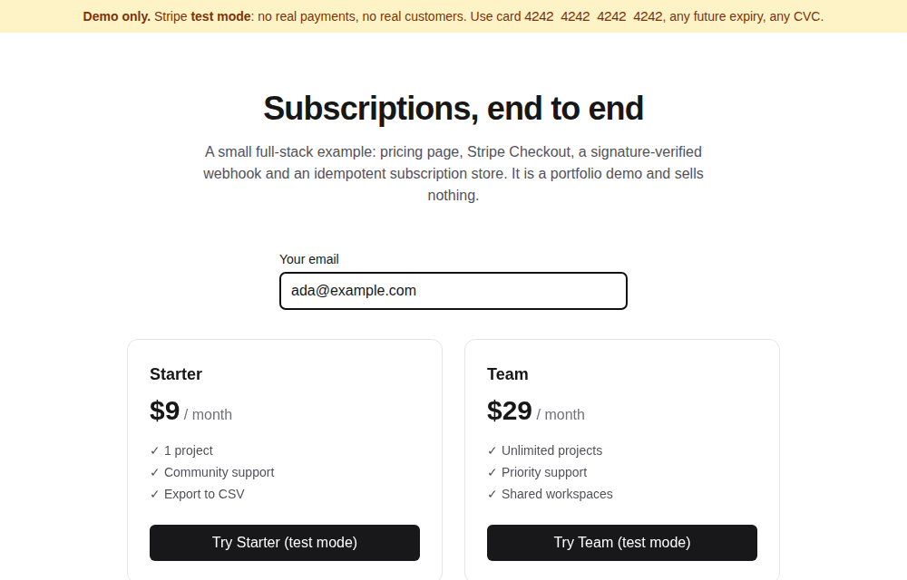
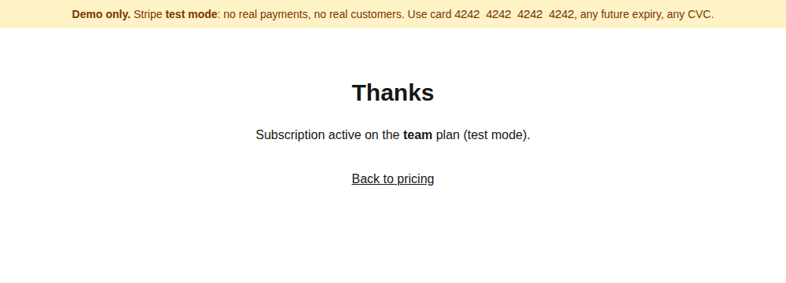

# Subscriptions demo (Stripe test mode)

[](https://github.com/codenlighten/saas-fullstack-demo/actions/workflows/ci.yml)

A small full-stack example: pricing page, Stripe Checkout, a signature-verified webhook and an idempotent subscription store, in Next.js and TypeScript.

> **This is a demo.** It runs against Stripe **test mode** only and sells nothing. It has no customers and takes no real payments. The app refuses to start checkout with any key that is not a `sk_test_` key.





*Both from this build running locally; the webhook behind the second one was signed by a script, not sent by Stripe.*

## What it shows

| Piece | Where | Why it is done this way |
|---|---|---|
| Checkout session creation | `src/lib/billing.ts` | Inline `price_data`, so no Stripe dashboard setup is needed. The Stripe client is injected, so tests use a stub. |
| Webhook endpoint | `src/app/api/webhooks/stripe/route.ts` | Reads the raw body and verifies Stripe's signature before touching any data. |
| Event handling | `applyEvent` in `src/lib/billing.ts` | **Atomic** (the event claim and the state change commit together, so a crash cannot lose an event), **idempotent** (each event id applies once), **order-safe** (a cancellation that arrives before its checkout event is remembered, keyed by Stripe subscription id) and **test-mode only** (live-mode events are ignored). |
| Test-key guard | `src/lib/config.ts` | A live key is a configuration error, not something to use. |
| Storage | `src/lib/store.ts` | A small `Store` interface over Node's built-in `node:sqlite` (experimental in Node 22), so there is nothing to install. Swapping in Postgres means implementing one interface. |
| Input validation | `src/app/api/*` | Request bodies and query strings are parsed with zod. |

## Run it

Needs Node 22 and a free Stripe account in test mode.

```bash
npm install
cp .env.example .env.local       # add your sk_test_ key
npm run dev
# in another terminal:
stripe listen --forward-to localhost:3000/api/webhooks/stripe   # prints the whsec_ secret for .env.local
```

Open http://localhost:3000, enter an email, pick a plan and pay with the test card `4242 4242 4242 4242`. The success page polls until the webhook has activated the subscription.

## Tests

```bash
npm test
npx playwright install chromium   # once: downloads the browser the next command drives
npm run test:e2e                  # builds the app, starts it and drives it; no Stripe account needed
```

The 14 tests cover the key guard, checkout parameters, event handling (activate, replay, cancel, ignore, rollback and retry, out-of-order delivery, old-versus-new subscription, live-mode and unpaid refusal) and real Stripe signature verification (valid, tampered, wrong secret), without network access. I also broke the code on purpose in seven places (replay protection, the key guard, rollback, out-of-order memory, the live-mode check, cancellation scoping) and confirmed the matching test failed each time.

An independent review (an OpenAI model, asked to find real problems) found the crash-loses-event gap and the out-of-order cancellation bug in the first version. Both are fixed and covered by tests.

The routes were also exercised against a running production build: unsigned, badly signed, tampered, valid and replayed webhooks behaved as above.

### In a browser

12 Playwright tests drive the production build: the pricing page, the server's refusal of a bad email, the plan and email in the browser's checkout request, the success page turning to "active" when a signed webhook arrives, an already cancelled subscription never shown as active, a forged signature changing nothing, the page giving up after about 30 seconds, and no sideways scroll at 320 px. Stripe is never called: webhooks are signed in the test with a placeholder secret using Stripe's library, and the one checkout call that would reach Stripe is answered by the test, so what the server sends Stripe is covered by the unit tests, not here.

Writing them found a bug: **if the status request failed (offline, for instance), the success page waited for ever** instead of saying what to check. My first fix counted a failed request as a try; an independent review then pointed out that a request which never completes would still hang the page. The page now gives up on a 30-second deadline of its own, whatever the requests do, and a test holds a request open to check it. On the final code I broke the app on purpose in 14 places (signature check removed, email not sent, any subscription shown as active, each earlier version of the success page restored, polling never stopped, the deadline left running after success, among others) and a test failed each time.

## Limits (deliberate, for a demo)

- No user accounts or login. `GET /api/subscription?email=` returns the plan and status for any email, which a real product would protect.
- Subscription state defaults to memory, so it resets on restart (`DATABASE_PATH` persists it).
- Only `checkout.session.completed` and `customer.subscription.deleted` are handled. There is no handling of `customer.subscription.updated`, failed renewals, asynchronous payment methods, invoices, proration or a customer portal, so a failed renewal would leave a record "active". Card payments are the supported path.
- The default store is in memory and per process, so a deployed copy forgets state on restart and does not share it across instances. Set `DATABASE_PATH` (one process, one disk) for anything longer-lived.
- The browser tests stop at Stripe's door: they never load Stripe's hosted checkout page or receive a delivery from Stripe. Chromium only.

## Licence

MIT. See `LICENSE`.
